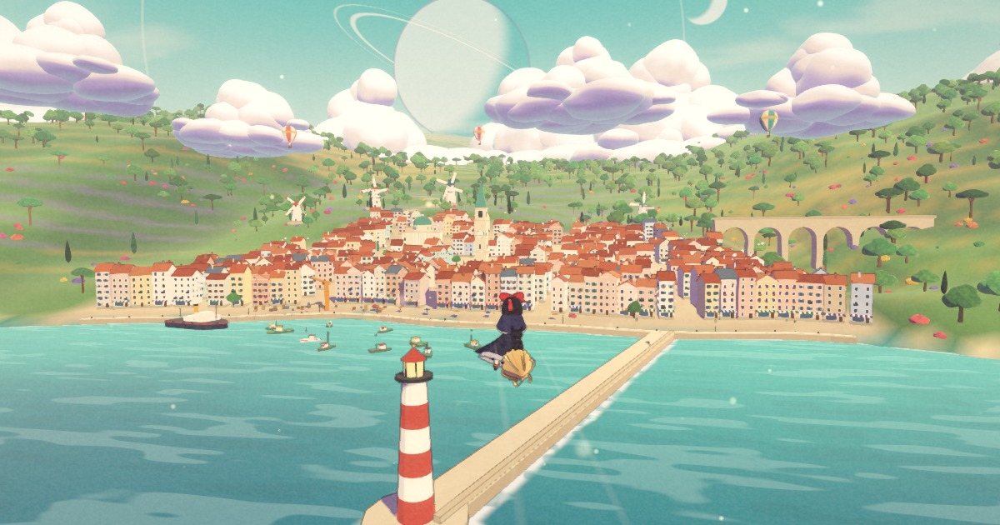

# Delivery Day · 魔女飞行 (Moebius & Ghibli Edition)

A young witch and her black cat soaring over a sun-drenched Mediterranean cliffside harbour town and the Prague river valley — built 100% procedurally in Three.js with zero external 3D models, textures, or audio files.



## Highlights

- **Three Live Art Styles** (instant zero-reload switching via `1 / 2 / 3` or top-right toolbar):
  1. **莫比乌斯 · 清线 (Moebius Ligne Claire — Default)**: Pastel turquoise-mint to peach-rose sky with a giant ringed celestial planet, crescent moon & orbital arc, whisper-thin plum-sepia ink outlines, shadow cross-hatching, watercolor paper grain, and floating pastel hot-air balloons.
  2. **吉卜力 · 晴夏 (Ghibli Summer)**: Luminous cerulean summer sky, silky sky-feathered cumulus clouds, warm gouache brushwork with cool periwinkle shadows, and lush pillowy botanical canopies.
  3. **金色 · 黄昏 (Golden Hour)**: Twilight violet-to-apricot sunset sky, liquid-gold water sparkles, sweeping volumetric lighthouse beam, and warm glowing dusk windows & street lanterns across the entire town.
- **Two Procedural Worlds** (switchable in the toolbar or via `?city=harbour` / `?city=prague`):
  - **海港风车城 (Harbour & Windmill Town — Default)**: Tiered coastal town, clock tower piazza, domed cathedral, 4 rotating hilltop windmills, 6-arch stone aqueduct/viaduct, fly-through natural limestone sea arch, lighthouse & fishing fleet.
  - **布拉格河谷 (Prague Valley)**: The Vltava river, Charles Bridge, Old Town Square & Astronomical Clock, Týn Church, Prague Castle & St Vitus Cathedral, Petřín tower, plus lush linden river promenades and distant mountain ridges.
- **Sculpted Witch, Stylized Broom & Black Cat**:
  - Layered short bob hair, twin-loop red ribbon bow with fluttering silk streamers, ivory-trimmed capelet, real-time cloth-rippling pleated skirt & petticoat, and burgundy boots.
  - Hand-carved oak broom with a unified fluted calligraphy-brush straw tail, brass/crimson binding collar with fluttering tassels, swinging brass fairy lantern, leather satchel with parchment scroll, expressive perched black cat, and delicate wind ribbons.

## Controls

| Key | Action |
|---|---|
| `W / S` or `↑ / ↓` | Faster · Slower |
| `A / D` or `← / →` | Bank left · right |
| `Space / Shift` | Climb · Descend |
| Hold mouse | Steer & climb with pointer |
| `1 / 2 / 3` | Switch style: Moebius · Ghibli · Golden Hour |
| `C` | Cycle camera: Flight · Wide · Witch Close-up |
| `P` | Toggle scenic autopilot |
| `H` | Hide all UI (for clean screen recording) |
| `M` | Mute synthesized Web Audio soundscape |

## Run Locally

Serve the folder with any static HTTP server:

```bash
python -m http.server 8080
```

Then open `http://localhost:8080/`. Optional URL query parameters: `?style=moebius|ghibli|golden`, `?city=harbour|prague`, `?auto`, `?clean`, `?fps`.

## Credits

Forked & heavily reimagined from [melvincarvalho/delivery-day](https://github.com/melvincarvalho/delivery-day). Everything (geometry, GLSL shaders, procedural textures, and Web Audio soundscape) is generated in code using Three.js.
